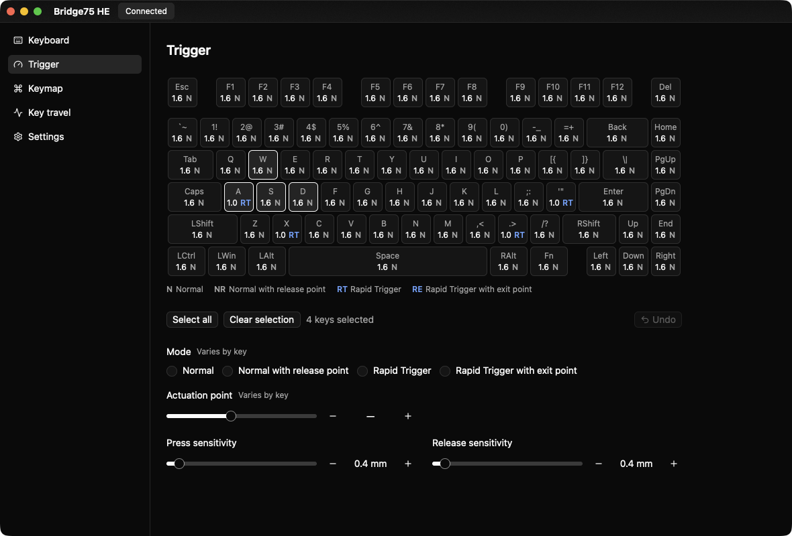
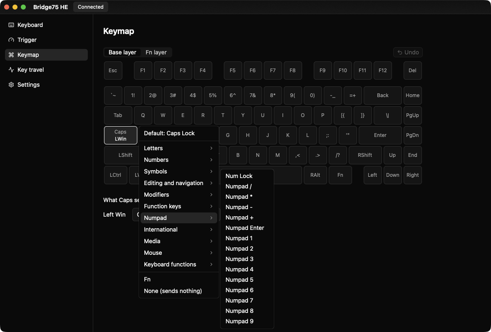
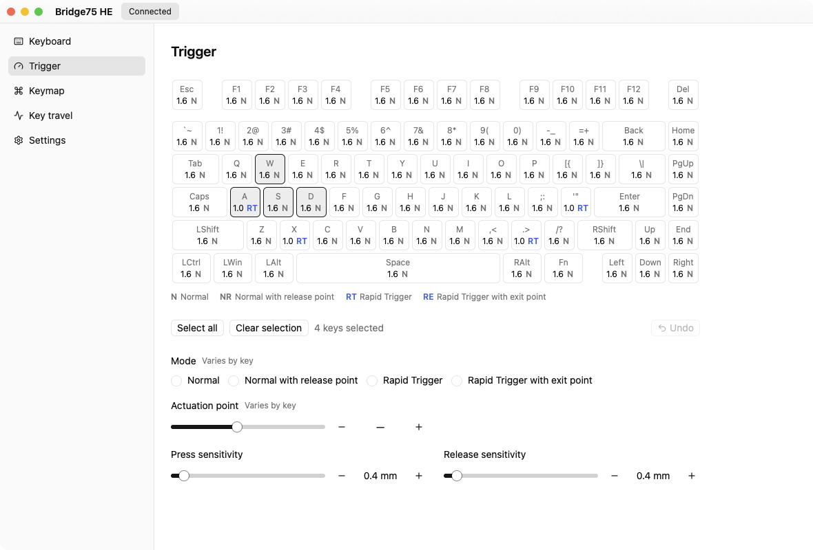

# open-bridge75-he

[English](README.md) | 日本語

磁気スイッチキーボード Bridge75 HE の非公式設定ツールです。コマンドラインツールと、開発中のデスクトップアプリ (GPUI Kit) があります。

公式の設定アプリ (Short Cut HE Config) は 2030-01-01 以降、SDK がすべての呼び出しを拒否するため使えなくなります。また、キーボードが持つ次の機能を扱えません。

- SOCD
- 終了位置なしのラピッドトリガーで、押し込み感度とリリース感度を別々にすること
- 生のセンサー値

詳しくは [docs/official-app.md](docs/official-app.md) (英語) を参照してください。







## Features

### Command-line tool (`bridge75`)

- [x] キーボード情報：FW バージョン、ビルド日時、シリアル番号、キャリブレーションの状態
- [x] キーごとのトリガー設定：作動位置、リリース位置、ラピッドトリガーの感度 (表示・設定・リセット)
- [x] デバウンス、ポーリングレート、スリープ時間
- [x] 1 キーまたは全キーのキャリブレーション
- [x] リアルタイムの押し込み量、生のセンサー値 (CSV に記録可)
- [x] SOCD ペア (表示はここで、書き込みはプロファイル経由)
- [x] TOML プロファイル：読み取れる設定のバックアップ、プロファイルの検査、キーマップ (通常・Fn レイヤー)・マクロ・アドバンスドキー (DKS、Mod-Tap、Toggle)・SOCD の書き込み

### Desktop app (`bridge75-app`)

- [x] 接続状態とキーボード情報
- [x] 実寸のキーボード上でのトリガー設定：変更するとすぐ書き込み、Ctrl+Z で元に戻す、キーボード操作に対応
- [x] リアルタイムの押し込み量
- [x] 英語・日本語の UI、ライト・ダーク表示
- [x] キーマップ (通常・Fn レイヤー)：キーボードから読み取れないため、キーボードごとにこのコンピューターに保存
- [ ] マクロ
- [ ] アドバンスドキー (DKS、Mod-Tap、Toggle)
- [ ] SOCD
- [ ] デバウンス、ポーリングレート、スリープ時間
- [ ] キャリブレーション
- [ ] TOML プロファイルを開く・保存する
- [ ] キーボードごとにマクロとアドバンスドキーを記憶する (キーボードから読み取れないため)
- [ ] 公式アプリから設定を取り込む

## Crates

| クレート | 内容 |
|---|---|
| `bridge75-core` | 共通の型と HID プロトコル：パケット、キーマトリクス、設定、TOML プロファイル。I/O なし |
| `bridge75-device` | hidapi による Raw HID 通信 |
| `bridge75-cli` | `bridge75` コマンド |
| `bridge75-app` | デスクトップアプリ (GPUI Kit)。既定ではビルドされません。UI の文言は `crates/bridge75-app/locales/app.yml` にあります |

## Build

Rust 1.85 以降が必要です。

```sh
cargo build --release          # target/release/bridge75
cargo run -p bridge75-app      # デスクトップアプリ
```

## Usage

```sh
bridge75 info                                      # FW バージョン、キャリブレーションの状態など
bridge75 trigger show                              # 全キーのトリガー設定
bridge75 trigger set all --mode rapid -a 1.6 --rt 0.8
bridge75 monitor w a s d                           # リアルタイムの押し込み量
bridge75 profile dump -o backup.toml               # 読み取れる設定をバックアップ
bridge75 profile apply my.toml                     # プロファイルを書き込む
```

すべてのコマンドは `bridge75 --help`、キー名は `bridge75 keys`、キー割り当ての書式は `bridge75 actions` で確認できます。

キーマップ、マクロ、アドバンスドキーはキーボードから読み取れません。TOML プロファイルに保存しておき、`profile apply` で書き込んでください。プロファイルに含まれないセクションは書き込まれません。

## Notes

- FW を更新すると、キーボードの設定はすべてリセットされます。先に `bridge75 profile dump` でバックアップしてください。
- `calibrate` と `trigger reset` の実行中はキーに触れないでください。どちらも送信前に 3 秒カウントダウンします。
- CLI は危険なコマンド (シリアル番号の書き込み、工場出荷時へのリセット、FW 更新) を送りません。

## Documentation

[docs/](docs/README.md) (英語) に、HID プロトコル、ファームウェアの内部、実機での測定結果をまとめています。

## Disclaimer

メーカーとは無関係の非公式プロジェクトです。自己責任で使用してください。このリポジトリにはファームウェアや公式アプリのバイナリは含まれていません。

## License

[Apache License, Version 2.0](LICENSE-APACHE) または [MIT license](LICENSE-MIT) のいずれかを選んで利用できます。

特に明示しない限り、このプロジェクトに含める目的で提出されたコントリビューション (Apache-2.0 ライセンスの定義による) は、追加の条件なしに上記のデュアルライセンスで提供されるものとします。
