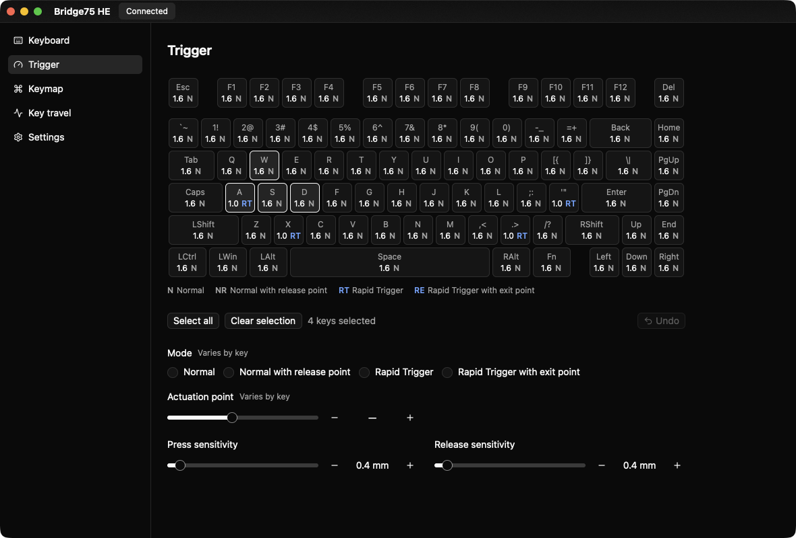
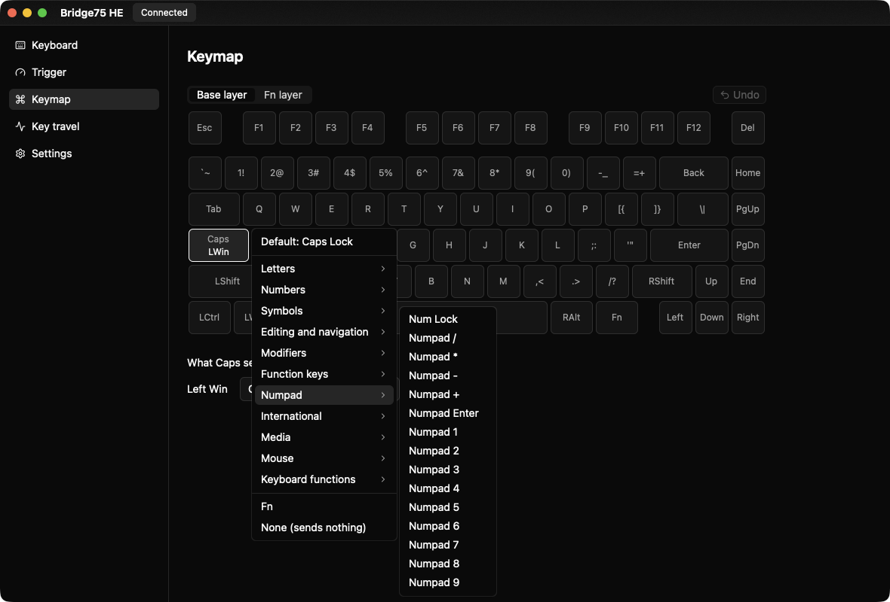
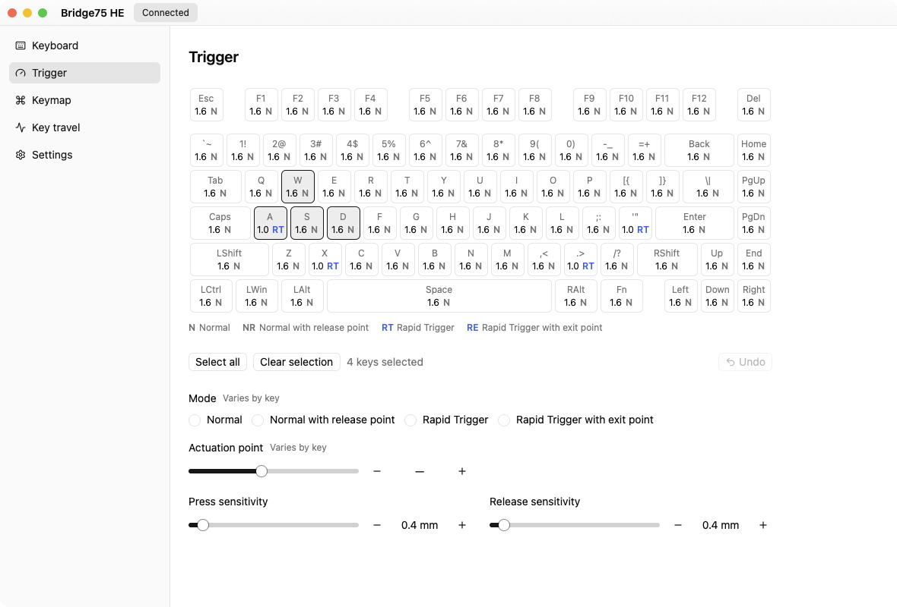

# open-bridge75-he

English | [日本語](README.ja.md)

An unofficial configurator for the Bridge75 HE magnetic keyboard. It provides a command-line tool and an early desktop app (GPUI Kit).

The official configurator (Short Cut HE Config) stops working on 2030-01-01, when its SDK starts refusing every call. It also leaves out some features of the keyboard:

- SOCD
- Different press and release sensitivity for Rapid Trigger without an exit point
- Raw sensor values

See [docs/official-app.md](docs/official-app.md) for details.







## Features

### Command-line tool (`bridge75`)

- [x] Keyboard info: FW version, build date, serial number, calibration status
- [x] Trigger settings per key: actuation point, release point, Rapid Trigger sensitivity (show, set, reset)
- [x] Debounce, polling rate and sleep time
- [x] Calibration of one key or all keys
- [x] Live key travel, and raw sensor values with CSV recording
- [x] SOCD pairs (shown here, written through a profile)
- [x] TOML profiles: back up the readable settings, check a profile, and write the keymap (base and Fn layers), macros, advanced keys (DKS, Mod-Tap, Toggle) and SOCD

### Desktop app (`bridge75-app`)

- [x] Connection status and keyboard info
- [x] Trigger settings on a to-scale keyboard: written as soon as they change, undo with Ctrl+Z, keyboard navigation
- [x] Live key travel
- [x] English and Japanese UI, light and dark appearance
- [x] Keymap (base and Fn layers): kept on this computer for each keyboard, since the keyboard cannot report it
- [ ] Macros
- [ ] Advanced keys (DKS, Mod-Tap, Toggle)
- [ ] SOCD
- [ ] Debounce, polling rate and sleep time
- [ ] Calibration
- [ ] Open and save TOML profiles
- [ ] Remember the macros and advanced keys of each keyboard (the keyboard cannot report them)
- [ ] Import settings from the official configurator

## Crates

| Crate | Contents |
|---|---|
| `bridge75-core` | Common types and the HID protocol: packets, key matrix, settings, TOML profiles. No I/O |
| `bridge75-device` | Raw HID communication through hidapi |
| `bridge75-cli` | The `bridge75` command |
| `bridge75-app` | Desktop app (GPUI Kit). Not built by default. UI text is in `crates/bridge75-app/locales/app.yml` |

## Build

Requires Rust 1.85 or later.

```sh
cargo build --release          # target/release/bridge75
cargo run -p bridge75-app      # desktop app
```

## Usage

```sh
bridge75 info                                      # FW version, calibration status, ...
bridge75 trigger show                              # trigger settings of all keys
bridge75 trigger set all --mode rapid -a 1.6 --rt 0.8
bridge75 monitor w a s d                           # live key travel
bridge75 profile dump -o backup.toml               # back up the readable settings
bridge75 profile apply my.toml                     # write a profile
```

Run `bridge75 --help` for all commands, `bridge75 keys` for key names and `bridge75 actions` for the key assignment syntax.

The keyboard cannot report its keymap, macros or advanced keys, so keep them in a TOML profile and write them with `profile apply`. Sections left out of a profile are not written.

## Notes

- Updating the FW resets every setting on the keyboard. Back up with `bridge75 profile dump` first.
- Keep your hands off the keys during `calibrate` and `trigger reset`. Both count down 3 s before sending.
- The CLI never sends the dangerous commands (serial number write, factory reset, FW update).

## Documentation

[docs/](docs/README.md) describes the HID protocol, the firmware internals and measurements on the real keyboard.

## Disclaimer

This is an unofficial project, not affiliated with the manufacturer. Use it at your own risk. The repository does not include firmware or official app binaries.

## License

Licensed under either of [Apache License, Version 2.0](LICENSE-APACHE) or [MIT license](LICENSE-MIT) at your option.

Unless you explicitly state otherwise, any contribution intentionally submitted for inclusion in this project by you, as defined in the Apache-2.0 license, shall be dual licensed as above, without any additional terms or conditions.
